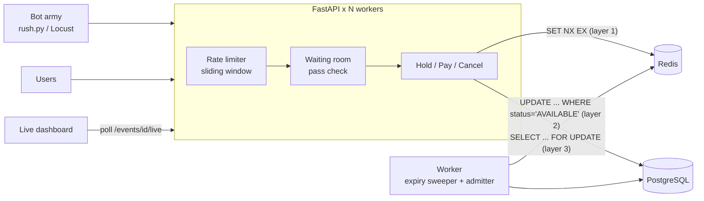

# TatkalProof

**A ticket booking REST API that survives an IRCTC Tatkal-style rush.**

Every day at 10 AM, lakhs of people hit the Tatkal booking page at the same second, all fighting over a few hundred seats. TatkalProof is a FastAPI booking backend built for exactly that moment, plus a load-testing "bot army" that proves it works.

It ships two versions of the same booking flow:

| | `/naive/book` | `/bookings/hold` + `/bookings/{id}/pay` |
|---|---|---|
| Approach | Check if free, then book | Redis lock, compare-and-set, row locks |
| Under a 2,000-user rush | **Sells the same seat many times** | Exactly one ticket per seat |
| Double "Pay" click | n/a | Charged once (idempotency keys) |
| Traffic spikes | Database takes the full hit | Rate limiting + virtual waiting room |

Run the rush, watch the naive version oversell on the live dashboard, then watch the hardened version hold at **0 double bookings**.

---

## Architecture



### How a seat is protected: three independent layers

1. **Redis lock** `SET seat:{event}:{seat} <user> NX EX 300`
   Atomic, so exactly one request wins. The other 1,999 are rejected in about a millisecond without touching Postgres. The TTL means a crashed client can never lock a seat forever. Releasing uses a Lua compare-and-delete so a slow client can't delete someone else's lock.

2. **Compare-and-set UPDATE in Postgres**
   `UPDATE seats SET status='HELD' ... WHERE id=? AND status='AVAILABLE'` and check `rowcount == 1`. Even if Redis fails over and loses the lock, the database itself only lets one transaction move the row out of `AVAILABLE`. There's a test that wipes Redis mid-flow to prove this.

3. **Pessimistic row locks for payment**
   `SELECT ... FOR UPDATE` on the booking, then the seat (always in that order, everywhere, so the payment path, cancel path and expiry sweeper can never deadlock). The payment gateway is called **outside** any transaction so a slow gateway never holds a DB connection or row lock.

### Other production patterns

- **Idempotent payments.** `POST /bookings/{id}/pay` requires an `Idempotency-Key` header (Stripe-style). A unique constraint on `(user, key)` guarantees only one request does the work; retries and double-clicks get the stored response with `Idempotent-Replayed: true`. Reusing a key for a different booking returns `422`.
- **Hold expiry.** Holds last 5 minutes. A background sweeper frees abandoned seats; if a hold expires *while* the payment is processing, the booking is refused and the charge refunded.
- **Sliding-window rate limiter.** Two Redis keys per user. It blocks the 2x burst that a fixed window allows at window boundaries.
- **Virtual waiting room.** A Redis sorted set acts as a FIFO queue; the admitter pops N users per second with `ZPOPMIN` and gives each a time-limited pass. Toggle it live from the dashboard.
- **Stateless JWT auth.** Booking requests cost zero DB queries for authentication.
- **bcrypt off the event loop.** Password hashing runs in a thread pool so registrations don't freeze bookings.
- **Shared live metrics.** RPS, p50/p95/p99 latency and outcome counters aggregated in Redis across all workers, via a pure-ASGI middleware.

---

## Quick start

### Option A: Docker (Postgres + Redis + 4 API workers + background worker)

```bash
docker compose up --build
```

- API docs: http://localhost:8000/docs
- Live dashboard: http://localhost:8000/dashboard (admin token: `admin-secret`)

### Option B: no Docker, no Postgres, no Redis

Uses SQLite and an in-memory fake Redis. Good for a quick look; use Option A for real load numbers.

```bash
python -m venv .venv
source .venv/bin/activate          # Windows: .venv\Scripts\activate
pip install -r requirements-dev.txt

# Windows PowerShell: $env:DATABASE_URL="sqlite+aiosqlite:///./tatkal.db"; $env:REDIS_URL="fake://"
export DATABASE_URL=sqlite+aiosqlite:///./tatkal.db REDIS_URL=fake://
python -m app.cli seed
uvicorn app.main:app --reload
```

---

## Run the rush

With the server running, open the dashboard in one window and run:

```bash
pip install httpx
python loadtest/rush.py --mode both --users 2000
```

It registers 2,000 users, lines them all up behind a starting gun, fires every request at once against the naive endpoint, resets, then does the same against the hardened endpoint. 20% of the hardened-flow winners "double-click" Pay. Output looks like:

```
                        NAIVE                       SAFE
------------------------------------------------------------------------------------
Users / seats           2000 / 100                  2000 / 100
Throughput (req/s)      ...                         ...
p50 / p95 / p99 (ms)    ...                         ...
Seats booked            ...                         ...
Tickets issued          ...                         ...
DOUBLE-BOOKED SEATS     ...                         0
Extra tickets sold      ...                         0
Duplicate charges       n/a                         0
```

Results are saved to `loadtest/results/*.json`. Useful flags:

| Flag | What it does |
|---|---|
| `--hot-seats 10` | Everyone fights over 10 seats (a nastier race) |
| `--double-click-rate 0.5` | Half the winners mash Pay twice |
| `--users 5000` | Bigger rush |
| `--event-id 1` | Reuse an event (it gets reset) |

For sustained load instead of a single spike, use Locust:

```bash
locust -f loadtest/locustfile.py --host http://localhost:8000
```

---

## Tests

```bash
pytest -v
```

The suite runs on SQLite + fake Redis, so it needs no services. It includes:

- `test_naive_flow_double_books_under_concurrency`: proves the bug exists (20 users, 1 seat, multiple tickets)
- `test_safe_flow_never_double_books`: 30 users on 3 seats, exactly 3 winners
- `test_db_guard_holds_even_if_redis_loses_the_lock`: wipes Redis mid-flow, Postgres still blocks the second hold
- `test_double_click_pay_charges_once`: 5 concurrent pays with one key, one payment reference
- expiry, cancellation, max holds per user, rate limiting, waiting room, admin reset

CI (`.github/workflows/ci.yml`) also boots real Postgres and Redis, runs a 300-user rush, and **fails the build if the hardened flow ever double-books or double-charges**.

---

## API overview

| Method | Path | Notes |
|---|---|---|
| POST | `/auth/register` | Returns a JWT |
| POST | `/auth/login` | OAuth2 password form |
| GET | `/events`, `/events/{id}`, `/events/{id}/seats?status=AVAILABLE` | Browse |
| GET | `/events/{id}/live` | Dashboard feed: seat map, oversell report, metrics |
| POST | `/naive/book` | Intentionally broken flow |
| POST | `/bookings/hold` | Hold a seat for 5 min (rate limited, waiting-room aware) |
| POST | `/bookings/{id}/pay` | Needs `Idempotency-Key` header |
| POST | `/bookings/{id}/cancel` | Frees the seat |
| GET | `/bookings/me` | Your bookings |
| POST | `/queue/{event_id}/join`, GET `/queue/{event_id}/status` | Waiting room |
| POST | `/admin/events`, `/admin/events/{id}/reset`, PUT `/admin/flags` | Needs `X-Admin-Token` |

Error responses share one shape: `{"error": "seat_unavailable", "detail": "..."}` with `409` (taken), `410` (hold expired), `429` (rate limited, with `Retry-After`), `403` (not admitted from the waiting room).

---

## Deploying (free tier)

**Render:** create a Postgres database and a Redis (Key Value) instance, then a Web Service from this repo using the Dockerfile. Set `DATABASE_URL` (change the scheme to `postgresql+asyncpg://`), `REDIS_URL`, `JWT_SECRET` and `ADMIN_TOKEN`. Leave `RUN_BACKGROUND_WORKERS=true` if you run a single web service.

**Railway:** add the Postgres and Redis plugins, deploy the repo, and set the same variables.

---

## Project structure

```
app/
  main.py             FastAPI app, middleware, lifespan
  services/booking.py naive flow, hold, pay, cancel, expiry sweeper  <- start here
  locks.py            Redis SET NX EX + Lua compare-and-delete
  idempotency.py      Stripe-style idempotency keys
  ratelimit.py        sliding-window-counter limiter
  waiting_room.py     Redis sorted-set queue + admitter
  metrics.py          ASGI metrics middleware, Redis-backed counters
  worker.py           background sweeper/admitter (in-process or standalone)
  routers/            auth, events, bookings, naive, queue, admin
  static/dashboard.html
loadtest/rush.py      one-shot spike simulator with before/after table
loadtest/locustfile.py sustained load
tests/                pytest suite
```

---

## Talking points for interviews

- **Why is the naive version broken if every line looks correct?** It's check-then-act: every request reads `AVAILABLE` before any of them writes. The bug only exists under concurrency, which is why it passes single-user tests.
- **Why both Redis and a DB guard?** Redis is the fast filter that keeps thousands of losers away from Postgres. The DB constraint is the source of truth that stays correct even when Redis loses data.
- **Why call the payment gateway outside the transaction?** Holding a row lock or pooled connection across a 100 ms+ network call would cap throughput at pool size / gateway latency.
- **What if the hold expires mid-payment?** The final step re-checks ownership under a row lock and refunds if the hold is gone.
- **How do you avoid deadlocks?** One global lock order (booking row, then seat row) on every path.
- **Fixed vs sliding window rate limits?** A fixed window lets a client send 2x the limit across a boundary; the sliding-window counter weights the previous window to smooth it out.
